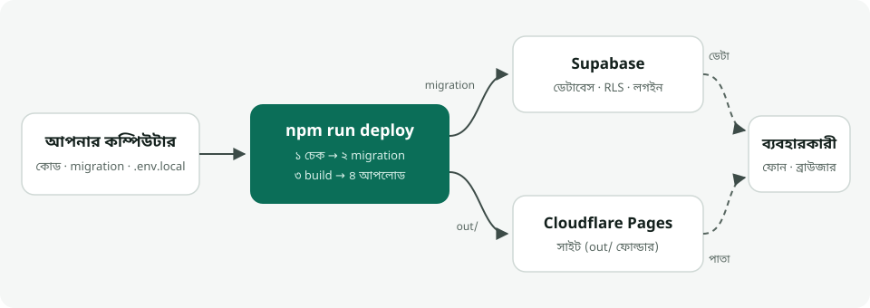

# Deploy গাইড — Supabase + Cloudflare Pages



একটা কমান্ডে দুটোই আপডেট হয়:

```bash
npm run deploy
```

এটা পরপর চারটা কাজ করে — কোনোটা ব্যর্থ হলে সেখানেই থামে, তাই অর্ধেক-আপডেট হয় না:

| ধাপ | কী হয় |
|---|---|
| ১. চেক | কমিট না করা পরিবর্তন, `.env.local`, টাইপ ও লিন্ট |
| ২. Supabase | `supabase/migrations/`-এর যে ফাইল এখনো চলেনি, শুধু সেগুলো চালায় (চালানোর আগে তালিকা দেখিয়ে `Y` চায়) |
| ৩. Build | `out/` ফোল্ডারে স্ট্যাটিক সাইট |
| ৪. Cloudflare | `out/` আপলোড — `main` ব্রাঞ্চ থেকে হলে আসল সাইট, অন্য ব্রাঞ্চ থেকে হলে আলাদা preview লিংক |

---

## প্রথমবার (একবারই করতে হবে)

### ০. যা লাগবে

- Node.js 22 বা নতুন
- এই repo-তে একবার `npm install` — Supabase CLI আর Wrangler (Cloudflare-এর টুল) এর সাথেই চলে আসে
- Supabase আর Cloudflare-এ ফ্রি অ্যাকাউন্ট

### ১. Supabase project

1. [supabase.com](https://supabase.com) → **New project**
   - Region: **Southeast Asia (Singapore)** — বাংলাদেশের সবচেয়ে কাছে
   - Database password কোথাও লিখে রাখুন — পরে লাগবে
2. Project খুললে ব্রাউজারের ঠিকানায় থাকবে `supabase.com/dashboard/project/<REF>` — এই `<REF>` (২০ অক্ষর) কপি করুন
3. টার্মিনালে:

   ```bash
   npx supabase login
   npx supabase link --project-ref <REF>
   npx supabase db push --include-seed
   ```

   শেষ লাইনটা সব টেবিল, নিয়ম (RLS) আর নমুনা ডেটা বসায়।

   > আগে SQL Editor-এ `init.sql` আর `seed.sql` হাতে চালিয়ে থাকলে `db push`-এর বদলে একবার এটা চালান, যাতে CLI জানে ওটা আগেই হয়ে গেছে:
   > ```bash
   > npx supabase migration repair 20261018000000 --status applied
   > ```

4. Dashboard থেকে দুটো মান নিন — **Project URL** (Project Settings → Data API, বা উপরের **Connect** বোতাম) আর **Publishable key** (Project Settings → API Keys, `sb_publishable_…` দিয়ে শুরু)
5. `.env.example` কপি করে `.env.local` বানিয়ে বসান:

   ```
   NEXT_PUBLIC_SUPABASE_URL=https://<REF>.supabase.co
   NEXT_PUBLIC_SUPABASE_PUBLISHABLE_KEY=sb_publishable_...
   ```

   > `secret` বা `service_role` key কখনো এখানে দেবেন না — এই দুটো মান ব্রাউজারে যায়। `.env.local` git-এ ওঠে না।

6. যাচাই: `npm run dev` → নিউ মার্কেটের পাতায় ৬টা দোকান দেখালে Supabase ঠিকমতো যুক্ত।

### ২. Cloudflare Pages

```bash
npx wrangler login
npx wrangler pages project create community-based-helper --production-branch main
```

প্রথম কমান্ড ব্রাউজারে Cloudflare লগইন খোলে। দ্বিতীয়টা project বানায় — সাইটের ঠিকানা হবে `https://community-based-helper.pages.dev` (নামটা কারো নেওয়া থাকলে Cloudflare শেষে কিছু অক্ষর যোগ করে)।

> অন্য নাম চাইলে project বানানোর সময় সেই নাম দিন, আর deploy-এর সময় `PAGES_PROJECT=<নাম> npm run deploy`।

### ৩. প্রথম deploy

সব commit করে:

```bash
npm run deploy
```

শেষে Cloudflare লিংক দেখাবে। নিজের ডোমেইন পরে Cloudflare dashboard → Workers & Pages → project → **Custom domains** থেকে যোগ করা যায়।

---

## প্রতিবার আপডেট

### শুধু কোড বা ডিজাইন বদলালে

```bash
git add -A && git commit -m "কী বদলালেন"
npm run deploy
```

### ডেটাবেস বদলালে (নতুন টেবিল, কলাম, নিয়ম)

1. নতুন migration ফাইল বানান:

   ```bash
   npm run db:new -- add_shop_photos
   ```

   `supabase/migrations/<সময়>_add_shop_photos.sql` তৈরি হবে।
2. ফাইলে SQL লিখুন। **পুরনো migration ফাইল কখনো বদলাবেন না** — Supabase সেটা আগেই চালিয়ে ফেলেছে; সংশোধন লাগলে নতুন ফাইলে লিখুন।
3. commit → `npm run deploy`। script আগে দেখাবে কোন ফাইল চালাবে, `Y` চাপলে চালাবে।

### নমুনা ডেটা বদলালে

`src/data/*.json` বদলে `npm run seed:sql` চালালে `supabase/seed.sql` নতুন হয়। এটা শুধু নতুন বা পরীক্ষার ডেটাবেসের জন্য — আসল সাইটে প্রতি deploy-এ seed চলে না, যাতে আসল ডেটা নষ্ট না হয়।

---

## সমস্যা হলে

| দেখাচ্ছে | কারণ ও সমাধান |
|---|---|
| `কমিট না করা পরিবর্তন আছে` | যা deploy হবে তা git-এ থাকা চাই — আগে commit করুন |
| `.env.local-এ … নেই` | প্রথমবারের ধাপ ১.৪–১.৫ |
| `db push` পাসওয়ার্ড চায় | Supabase project বানানোর সময়ের database password |
| `already exists` error | টেবিল আগে হাতে বানানো হয়েছিল — উপরের `migration repair` কমান্ড একবার চালান |
| Wrangler বলে লগইন নেই | `npx wrangler login` |
| সাইটে “তথ্য আনা যায়নি” | ফ্রি Supabase project ৭ দিন কেউ না খুললে থেমে যায় — dashboard → **Restore** |
| বাংলাদেশে Cloudflare খুলছে না | একই `out/` ফোল্ডার Netlify বা Vercel-এ দিলেই চলে — কোড বদলাতে হয় না |
