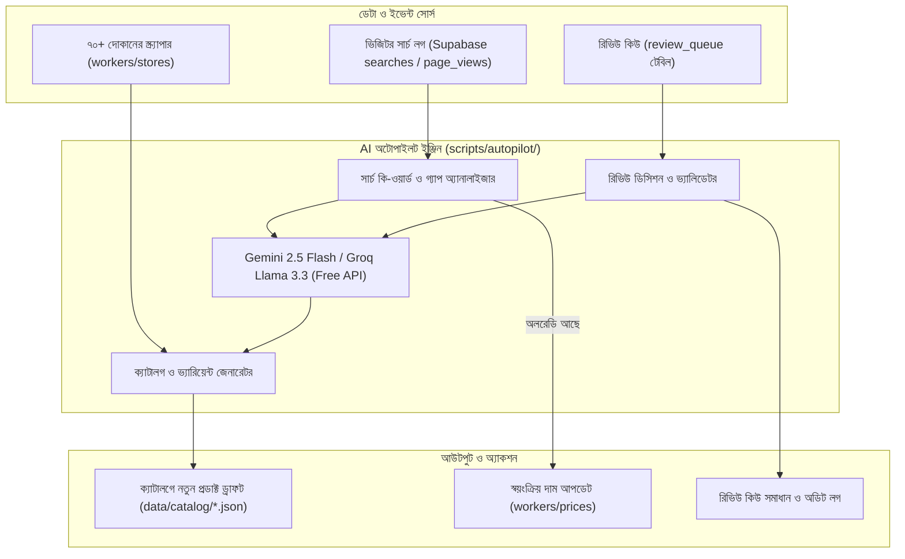
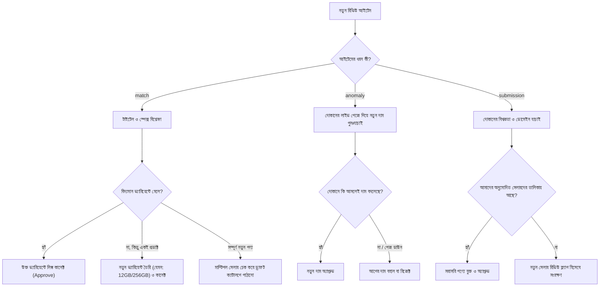

# প্রস্তাবনা: সম্পূর্ণ বিনামূল্যে AI প্রোডাক্ট অপস অটোপাইলট (AI Product Ops Autopilot)

**প্রজেক্ট:** দরদাম (Dordam)  
**তারিখ:** ৩১ অক্টোবর, ২০২৬  
**অবস্থা:** পর্যালোচনার জন্য প্রস্তাবিত (Proposed for Investigation)  
**উদ্দেশ্য:** অ্যাডমিনের নিয়মিত প্রোডাক্ট অ্যানালাইসিস, ক্যাটালগ সংযোজন এবং রিভিউ কিউ সমাধানের কাজগুলো সম্পূর্ণ বিনামূল্যে (৳০ খরচে) AI দিয়ে স্বয়ংক্রিয় করা।

---

## ১. প্রেক্ষাপট ও বর্তমান সমস্যা

দরদাম সাইটে নিয়মিত কার্যক্রম পরিচালনার জন্য বর্তমানে অ্যাডমিনকে দুটি কাজ ম্যানুয়ালি করতে হয়:

1. **সার্চ কি-ওয়ার্ড বিশ্লেষণ ও গ্যাপ পূরণ:** সাইটে ভিজিটররা কোন প্রডাক্টগুলো বেশি সার্চ করছেন তা পর্যবেক্ষণ করা, যে প্রডাক্টগুলো সাইটে নেই সেগুলো চিহ্নিত করা, ইন্টারনেটে একাধিক দোকানে খোঁজ করা (কমপক্ষে ২-৩+ সেলার থাকতে হবে) এবং ৪-৫টি নতুন প্রডাক্ট স্পেক্সসহ ক্যাটালগে যুক্ত করা। আর প্রডাক্ট অলরেডি থাকলে অপ্রয়োজনীয় ডুপ্লিকেট না বানিয়ে কেবল দাম সিঙ্ক করা।
2. **রিভিউ কিউ (Review Queue) সমাধান:** নতুন আসা লিস্টিং ও ইউজারের সাবমিশন পর্যবেক্ষণ করা, ভিন্ন র‍্যাম/রম বা সাইজের জন্য নতুন ভ্যারিয়েন্ট তৈরি করা, নতুন ব্রান্ড ও বিশ্বস্ত সেলার যাচাই করে অ্যাপ্রুভ/রিজেক্ট করা।

এই কাজগুলোতে অনেক সময় প্রয়োজন হয়। একটি স্বয়ংক্রিয় **AI Product Ops Agent** এই পুরো প্রক্রিয়া মানুষের হস্তক্ষেপ ছাড়াই বা মানুষের ন্যূনতম নজরদারিতে সমাধান করতে পারে।

---

## ২. আর্কিটেকচার ও ১০০% ফ্রি কাঠামো (Free-tier Tech Stack)

পুরো সিস্টেমটি এমনভাবে ডিজাইন করা হয়েছে যাতে কোনো পেইড সাবস্ক্রিপশন ছাড়াই লাইফটাইম ফ্রিতে চলে:

### ফ্রি সার্ভিসের বিবরণ ও খরচ বিশ্লেষণ:

| উপাদান | প্রযুক্তি | ফ্রি টিয়ার সীমা | আমাদের প্রয়োজনীয়তা | খরচ |
|---|---|---|---|---|
| **AI ব্রেন** | Google Gemini 2.5 Flash | ১৫ RPM, ১,৫০০ রিকোয়েস্ট/দিন | দিনে ২০-৫০ রিকোয়েস্ট | **৳০ (ফ্রি)** |
| **বিকল্প AI** | Groq (Llama 3.3 70B) | ৩০ RPM, ১৪,৪০০ রিকোয়েস্ট/দিন | ফলব্যাক হিসেবে ব্যবহার | **৳০ (ফ্রি)** |
| **অটোমেশন রানার** | GitHub Actions Cron | ২,০০০ মিনিট/মাস | দিনে ১ বার চললে ~৬০ মিনিট/মাস | **৳০ (ফ্রি)** |
| **লোকাল রানার** | Node.js + tsx | আনলিমিটেড (আপনার পিসিতে) | যখন খুশি ম্যানুয়াল রান | **৳০ (ফ্রি)** |
| **ডেটাবেস** | Supabase Postgres | ৫০০ MB ডেটা, ৫০,০০০ MAU | অটোপাইলটের লগ ও স্ট্যাটাস | **৳০ (ফ্রি)** |

---

## ৩. মডিউল ১: সার্চ কি-ওয়ার্ড অ্যানালাইসিস ও অটো-ক্যাটালগ

### কাজের ধাপসমূহ:

1. **সার্চ লগ থেকে টপ কি-ওয়ার্ড সংগ্রহ:**
   - ডেটাবেসের `page_views` ও সার্চ ট্র্যাকিং থেকে গত ৭/৩০ দিনের সর্বোচ্চ খোঁজা কি-ওয়ার্ডগুলো বের করা হবে।
   - বিশেষ করে যে সার্চগুলোতে কোনো ফলাফল পাওয়া যায়নি (**Zero-match queries**), সেগুলোকে অগ্রাধিকার দেওয়া হবে।

2. **ক্যাটালগ কভারেজ টেস্ট (Coverage Matching):**
   - AI বর্তমান ক্যাটালগের (`data/catalog/*.json`) সাথে কি-ওয়ার্ডটি মেলাবে।
   - **যদি প্রডাক্টটি অলরেডি ক্যাটালগে থাকে:** কোনো নতুন প্রডাক্ট বানানো হবে না। সরাসরি বিদ্যমান প্রডাক্টের সেলার লিঙ্কগুলোর ওপর দামের সিঙ্ক (`workers/prices.ts`) চালানো হবে যাতে লেটেস্ট দাম প্রদর্শিত হয়।
   - **যদি প্রডাক্টটি ক্যাটালগে না থাকে:** পরবর্তী ধাপে নতুন প্রডাক্ট খোঁজার প্রক্রিয়া শুরু হবে।

3. **দোকান স্ক্র্যাপিং ও মাল্টি-সেলার যাচাই (Multi-Seller Verification):**
   - আমাদের বিদ্যমান স্ক্র্যাপারগুলো দিয়ে বাংলাদেশের অনুমোদিত দোকানগুলোতে (Star Tech, Apple Gadgets, Shajgoj, eFamas ইত্যাদি) কি-ওয়ার্ডটি দিয়ে সার্চ চালানো হবে।
   - **কঠোর নিয়ম (Strict Rules):**
     - একটি মাত্র দোকানে পাওয়া গেলে প্রডাক্টটি সরাসরি লাইভ হবে না।
     - **কমপক্ষে ২টি বা ততোধিক দোকানে (পছন্দনীয় ৩+)** প্রডাক্টটি পাওয়া গেলেই কেবল এটি ক্যাটালগে যুক্ত হওয়ার যোগ্য হবে।

4. **স্পেসিফিকেশন তৈরি ও ক্যাটালগ এন্ট্রি:**
   - AI বিভিন্ন দোকানের বিবরণী থেকে প্রডাক্টের সঠিক মডেল, ব্র্যান্ড, ক্যাটাগরি, অক্ষ (যেমন: RAM/Storage/Color/Size) এবং স্পেক্স জেনারেট করবে।
   - স্বয়ংক্রিয়ভাবে `data/catalog/<category>.json`-এ নতুন ৪-৫টি প্রডাক্টের ফরম্যাটেড এন্ট্রি সাজিয়ে দেবে।

---

## ৪. মডিউল ২: স্মার্ট রিভিউ কিউ সমাধান (Review Queue Resolver)

অ্যাডমিন প্যানেলের `/admin/review/` সেকশনে ৩ ধরণের আইটেম আসে:
1. `match` (নতুন লিস্টিং যা কোনো প্রডাক্টের সাথে মিলতে পারে)
2. `anomaly` (দামের অস্বাভাবিক বড় পরিবর্তন)
3. `submission` (ক্রেতাদের পাঠানো নতুন দাম বা দোকান)

### AI সমাধান প্রক্রিয়া:

---

## ৫. সেফটি ও কোয়ালিটি গার্ডরেইল (Safety & Control)

AI যাতে ভুল ডেটা বা কোনো আনভেরিফাইড তথ্য লাইভে পুশ না করে, তার জন্য নিচের নিরাপত্তা ব্যবস্থা থাকবে:

1. **ড্রাফট মোড (Draft / Staging Mode):**
   - AI সরাসরি ডাটাবেসে বা লাইভ সাইটে কোনো পরিবর্তন করবে না।
   - এটি নতুন প্রডাক্টগুলো একটি স্টোর বা ড্রাফট ফাইলে সাজিয়ে রাখবে এবং অ্যাডমিনকে একটি সংক্ষেপ রিপোর্ট দেবে। অ্যাডমিন এক ক্লিকে "Apply All" বা "Reject" করতে পারবেন।
2. **কঠোর স্কিমা ভ্যালিডেশন:**
   - প্রতিটি নতুন প্রডাক্টের জন্য TypeScript টাইপ ও `strict-rules.md` নিয়মাবলি (যেমন: সঠিক ইমেজ URL, ব্র্যান্ড, ক্যাটাগরি, ন্যূনতম ২ সেলার) বাধ্যতামূলকভাবে যাচাই করা হবে।
3. **আনডু ও অডিট লগ:**
   - প্রতিটি সিদ্ধান্তের পেছনে AI-এর ব্যাখ্যা (`reason`) এবং তারিখ `admin_audit_logs`-এ সংরক্ষিত থাকবে, যাতে যেকোনো সিদ্ধান্ত প্রয়োজনে এক ক্লিকে Undo করা যায়।

---

## ৬. বাস্তবায়নের সম্ভাব্য ধাপসমূহ (Implementation Roadmap)

| ধাপ | কাজের নাম | বিবরণ |
|---|---|---|
| **Phase 1** | Search Gap Analyzer (`scripts/autopilot-search.ts`) | সার্চ অ্যানালিটিক্স পড়ে মিসিং কি-ওয়ার্ড ও ক্যাটালগ রিপোর্ট তৈরি করবে। |
| **Phase 2** | Catalog Staging Engine | মিসিং কি-ওয়ার্ডের জন্য শপ স্ক্র্যাপ করে ৩+ সেলারসহ নতুন প্রডাক্ট সাজাবে। |
| **Phase 3** | Review Queue Resolver (`scripts/autopilot-review.ts`) | Gemini Free API দিয়ে রিভিউ কিউ প্রসেস ও ভ্যারিয়েন্ট তৈরির স্ক্রিপ্ট। |
| **Phase 4** | Admin UI Integration | অ্যাডমিন প্যানেলের "অটোমেশন ও AI" পেজে "Run Autopilot" বোতাম ও সামারি ভিউ যোগ করা। |
| **Phase 5** | GitHub Actions Automation | প্রতিদিন রাতে একবার নিজে নিজে এই রুটিন চালিয়ে গিট PR তৈরি করা। |

---

## ৭. পরবর্তী পদক্ষেপ

এই প্রস্তাবটি পর্যালোচনা করুন। আপনি সম্মতি দিলে আমরা ফেজ-১ (সার্চ অ্যানালাইজার) থেকে কোড ইমপ্লিমেন্টেশন শুরু করতে পারি, অথবা আপনার কোনো পরিবর্তন বা অতিরিক্ত শর্ত থাকলে তা অন্তর্ভুক্ত করতে পারি।

