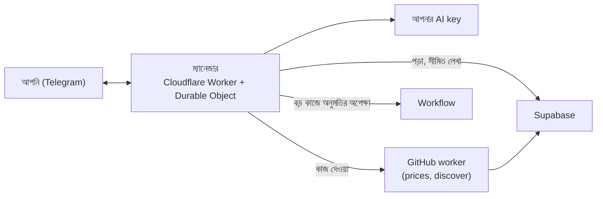

# প্রস্তাব: দরদামের AI ম্যানেজার (Cloudflare ফ্রি প্ল্যানে)

**প্রজেক্ট:** দরদাম
**তারিখ:** ৩১ অক্টোবর ২০২৬ (গবেষণার পরে নতুন করে লেখা)
**অবস্থা:** প্রস্তাব, এখনো কোনো কোড হয়নি
**এক কথায়:** OpenClaw-এর মতো একজন AI ম্যানেজার, যে Cloudflare-এর ফ্রি অ্যাকাউন্টে ২৪ ঘণ্টা থাকবে।
- আপনার সাথে Telegram-এ কথা বলবে।
- এখন যে কাজগুলো আপনাকে বা ডেভেলপারকে হাতে করতে হয়, তার বেশিরভাগ নিজে করবে।
- ছোট আর ফেরানো যায় এমন কাজ নিজে করবে। বড় বা ঝুঁকির কাজে আপনাকে জিজ্ঞেস করবে।

---

## ১. গবেষণায় যা পেলাম

### ক. এখন হাতে কী কী কাজ হয় (গত ১২ দিনের ১০৮টা commit আর অ্যাডমিন ড্যাশবোর্ড থেকে)

| বারবার যে কাজ হয় | উদাহরণ (commit বা ড্যাশবোর্ড থেকে) |
|---|---|
| নতুন মডেল যোগ | "নতুন প্রজন্মের ৩৪টা ফোন", "ল্যাপটপে ২০টা নতুন মডেল", "পুরনো কিন্তু চলতি ১৩৩টা মডেল" |
| ভাঙা ছবি ঠিক করা | "Apple Gadgets image URLs", "মধুর ৩ পণ্যের ভাঙা Chaldal ছবি" |
| এক দোকানে নেমে যাওয়া পণ্য বাদ | "এক দোকানে নেমে যাওয়া ৬টা ল্যাপটপ বাদ", "২ দোকানের কম ভ্যারিয়েন্ট বাদ" |
| দোকানের সাইট বদলালে লিংক ঠিক | "Trek N Tread-এর নতুন সাইট", Star Tech-এর "To be announced" |
| যাচাই বাকি সামলানো | ড্যাশবোর্ড: "Xটা জিনিস আপনার অনুমোদনের অপেক্ষায়" |
| ঘাটতি খোঁজা | ড্যাশবোর্ড: দাম নেই, ছবি নেই, স্পেসিফিকেশন নেই, ৩ বছরের পুরনো মডেল, বিক্রেতা যাচাই হয়নি |
| কাজ থেমে গেলে খেয়াল করা | ড্যাশবোর্ড: "দাম শেষ আনা হয়েছে...", "GitHub ৬০ দিন commit না হলে কাজ বন্ধ" |
| দোকান আটকে দিলে | data-sources: Arafa Telecom-এর bot challenge, Sell Tech-এর দাম মিলছে না |

এগুলোর প্রায় সবই একজন ম্যানেজার করতে পারে।

### খ. Cloudflare-এ যা তৈরি পাওয়া যায়

- **Think (`@cloudflare/think`):** Cloudflare-এর নিজের "AI কর্মী" কাঠামো। এতে আছে:
  - **স্মৃতি:** কথোপকথন আর নোট মনে রাখে, পুরনো কথা খুঁজে বের করতে পারে।
  - **Telegram বানানো আছে:** `telegramMessenger()` দিয়ে সরাসরি যুক্ত হয়, secret token দিয়ে যাচাই করে।
  - **নিজে থেকে কাজ শুরু:** নির্দিষ্ট সময়ে বা কোনো ঘটনায় নিজে "ভাবতে" বসে।
  - **টুল আর অনুমোদন:** টুল ব্যবহার করতে পারে, কোনো টুলে আগে অনুমোদন চাওয়া যায়।
  - **সতর্কতা:** Think এখনো "experimental"। তাই আমাদের কাজের অংশ (টুল আর নিয়ম) আলাদা রাখব, যাতে দরকার হলে সাধারণ Agent-এ সরানো যায়।
- **Workflows-এর অনুমোদন (`waitForApproval`):** কোনো কাজ দিন বা সপ্তাহ ধরে আপনার "হ্যাঁ"-এর অপেক্ষায় রাখা যায়, কিছু চালু না রেখেই। দরকারে মনে করিয়ে দেওয়া যায় ("৪ ঘণ্টা হলো, দেখবেন?")।
- **নিজের schedule:** Agent নিজের সময়সূচি নিজে রাখে, অ্যাকাউন্টের ৫টা cron trigger খরচ হয় না। একই কাজ দুবার চললেও সমস্যা হয় না এমনভাবে লিখতে হবে, কারণ মাঝপথে থামলে আবার চলে।

### গ. ফ্রি প্ল্যানের সীমা, আর আমরা কীভাবে তার মধ্যে থাকব

| সীমা | মানে | আমাদের উপায় |
|---|---|---|
| প্রতিবার ১০ms CPU | বড় HTML পার্স করা যাবে না | দোকানের পেজ পড়বে GitHub worker ("হাত"), ম্যানেজার শুধু ফল পড়বে |
| প্রতিবার ৫০টা বাইরের request | এক টানে অনেক কাজ করা যাবে না | লম্বা কাজ Workflow-এর ধাপে ভাগ, প্রতি ধাপে নতুন সীমা |
| ব্রাউজার দিনে ১০ মিনিট | ঘুরে ঘুরে খোঁজা যাবে না | শুধু মাঝেমধ্যে প্রমাণ দেখা |
| দিনে ১ লাখ request | — | আমাদের লাগবে কয়েকশো |

---

## ২. ম্যানেজারের দায়িত্বের তালিকা

### রোজ রাতে (discover শেষ হওয়ার পরে)

1. **যাচাই বাকি:**
   - নিশ্চিত আইটেম এখনকার মতোই worker নিজে মেটায়।
   - বাকিগুলোতে ম্যানেজার নোট লিখবে, যেমন "8/256, অনুমোদন দিন" বা "কভার, বাদ দিন"।
2. **নতুন পণ্য, দুই উৎস থেকে:**
   - ভিজিটর খুঁজেছে কিন্তু সাইটে নেই (শেষ ৭ দিন)।
   - দোকানে নতুন মডেল এসেছে, যেটা আমাদের নেই। রাতের `discover` যে লিস্টিং আনে কিন্তু কোনো পণ্যে মেলে না, সেখান থেকে ধরবে।
   - **২+ দোকানে আসল দাম** থাকলে পণ্যটা **লুকিয়ে** যোগ করবে।
   - `discover` দাম বসানোর পরে কোড দিয়ে যাচাই করবে: ২+ দোকান, মডেলের মিল, দামের সীমা, একই পণ্য আগে আছে কিনা।
   - সব ঠিক হলে **নিজেই চালু করবে**। সন্দেহ থাকলে আপনার জন্য রাখবে।
   - দিনে সর্বোচ্চ ৫টা।
3. **মেরামত:**
   - **ছবি:** ভাঙা ছবি থাকলে অন্য দোকানের আসল ছবি বসাবে।
   - **ঘাটতি:** স্পেসিফিকেশন আর বছর খালি থাকলে নির্ভরযোগ্য উৎস থেকে ভরবে।
   - **"To be announced":** এমন পেজ দেখলে সেই অফার বাদ রাখবে।
4. **নিয়ম পাহারা:**
   - কোনো ভার্সন এক দোকানে নেমে গেলে আপনাকে বলবে: "লুকাব?"। মোছা সবসময় আপনার অনুমতিতে।
   - ৩ বছরের পুরনো মডেলের জন্যও একই কাজ করবে।

### সারা দিন, পাহারাদারের মতো

5. **কাজ আটকে গেলে:**
   - কোনো কাজ ব্যর্থ হলে একবার নিজে আবার চালাবে।
   - আবারও ব্যর্থ হলে আপনাকে কারণসহ জানাবে, যেমন "Arafa Telecom bot challenge দিচ্ছে, ৬৩টা দাম আটকে আছে"।
6. **দাম পুরনো হলে:** ৮ ঘণ্টার বেশি নতুন দাম না এলে খোঁজ নেবে।
7. **ফ্রি সীমা:** ৮০% ভরলে আগেই সতর্ক করবে।
8. **GitHub-এর ৬০ দিনের নিয়ম:** ৫০ দিন commit না হলে মনে করিয়ে দেবে।

### সকাল ৯টায় রিপোর্ট (Telegram)

> সুপ্রভাত! কাল রাতে:
> ✅ ৩টা নতুন পণ্য যোগ করেছি (Redmi Note 15, ...)। ভুল হলে "লুকাও ১" লিখুন।
> 📝 যাচাই বাকির ৮টায় নোট লিখেছি। ২টা আপনার সিদ্ধান্ত লাগবে।
> 🔧 ৫টা ভাঙা ছবি ঠিক করেছি।
> ⚠️ Arafa Telecom আটকে দিচ্ছে। দোকানটা বন্ধ রাখব? (হ্যাঁ/না)

### আপনি যখন খুশি জিজ্ঞেস করবেন

- "Samsung A57 কোথায় সবচেয়ে সস্তা?"
- "এই সপ্তাহে মানুষ সবচেয়ে বেশি কী খুঁজেছে?"
- "দাম আনা এখনই চালাও"
- "iPhone 17-এর দাম কেমন বদলেছে?"

### পরে (ঐচ্ছিক): দোকানদারদের সাথে কথা

[ফিচার ১৫](features/15-telegram-bot.md)-এ পরিকল্পনা আছে: ফেসবুকে দাম দেওয়া দোকান Telegram-এ দাম পাঠাবে। একই ম্যানেজার সেটাও সামলাতে পারবে। মেসেজ বা স্ক্রিনশট পড়ে "ক্রেতার পাঠানো দাম"-এর মতো যাচাই বাকিতে পাঠাবে। এতে আলাদা Supabase Edge Function লাগবে না।

---

## ৩. কোন কাজ নিজে করবে, কোনটায় জিজ্ঞেস করবে

| স্তর | কাজ |
|---|---|
| 🟢 **নিজে করবে, পরে জানাবে** | কাজ চালানো বা আবার চালানো, দাম আবার খুঁজতে দেওয়া, যাচাই বাকিতে নোট লেখা, ভাঙা ছবি বা খালি ঘর ভরা, কড়া যাচাই পার হওয়া নতুন পণ্য যোগ (দিনে ৫টা পর্যন্ত) |
| 🟡 **জিজ্ঞেস করবে** (Telegram-এ হ্যাঁ বা না) | কোনো পণ্য বা ভার্সন লুকানো, দোকান বন্ধ রাখা, যাচাই না-পার হওয়া নতুন পণ্য, নতুন দোকানের প্রস্তাব |
| 🔴 **কখনো করবে না** | কিছু মোছা, সেটিং বা AI key বদলানো, অ্যাডমিন বানানো, কোড বদলানো |

**বিশ্বাসের সিঁড়ি:** প্রতি সপ্তাহে ম্যানেজারের হিসাব থাকবে, কত কাজ করেছে আর আপনি কতগুলো উল্টে দিয়েছেন। উল্টানো খুব কম হলে আপনি চাইলে কোনো 🟡 কাজ 🟢-তে তুলে দিতে পারবেন। বেশি হলে নামিয়ে দেবেন। এভাবে মানুষ কর্মীর মতোই ধীরে ধীরে দায়িত্ব বাড়বে।

**আপনার কাছ থেকে শিখবে:** আপনি কিছু উল্টে দিলে বা "না" বললে কারণসহ মনে রাখবে, যেমন "মালিক রেপ্লিকা জুতা 'official'-এ চান না"। পরের বার একই ভুল করবে না। worker-এর auto-review এখনই অ্যাডমিনের শেষ ২০টা সিদ্ধান্ত থেকে শেখে। ম্যানেজার একই কাজ আরও বড় পরিসরে করবে।

---

## ৪. কীভাবে বানানো হবে

- **ম্যানেজার:** একটা আলাদা Cloudflare Worker, Telegram-এর সাথে যুক্ত। ধাপ ১-এ Think বা Agents SDK না নিয়ে সাধারণ Durable Object দিয়ে বানানো হয়েছে: কাজ এতটুকুই, নতুন প্যাকেজ লাগেনি, আর Think এখনো experimental। এই repo-তে নতুন ফোল্ডার `agent/`-এ থাকবে, আলাদা `wrangler deploy`। সাইটের deploy-এ কোনো প্রভাব পড়বে না।
- **টুল:** প্রতিটা কাজের জন্য আলাদা ছোট টুল, যেমন `searchGaps`, `runJob`, `hideProduct`। প্রতিটা টুলে নিজস্ব নিয়ম কোডে লেখা থাকবে। AI চাইলেও নিয়ম ভাঙতে পারবে না।
- **ডেটাবেস:** ম্যানেজারের আলাদা সীমিত অ্যাকাউন্ট (Supabase migration)। 🔴 কাজগুলো ডেটাবেস নিজেই আটকাবে।
- **হিসাব:** প্রতিটা কাজ `audit_log`-এ থাকবে, কারণসহ।
- **অ্যাডমিনে "AI ম্যানেজার" পাতা (OpenClaw-এর Control UI-এর মতো):** গাঢ় কনসোল, ট্যাব: চ্যাট, চ্যানেল, কাজ, সময়সূচি, লগ, সেটআপ।
  - **চ্যাট:** ম্যানেজারের প্রতিটা কাজ টুল-ব্লকে, যেমন `jobs.run("prices")`, আর তার ফল। অনুমতির "হ্যাঁ/না" চ্যাটের ভেতরেই।
  - **পাশে অবস্থা:** সংযোগ (Telegram, AI মডেল, ডেটাবেস), কাজের লাইন অর্থাৎ workers যুক্ত কিনা বা কোনটা আটকে, এখন কী চলছে, সময়সূচি, আজকের হিসাব।
  - ডিজাইন অনুমোদিত (৩১ অক্টোবর)। বাকি ট্যাবের ডিজাইন পরে।
- **খরচ:** Cloudflare, GitHub আর Supabase ৳০। AI আপনার key থেকে, দিনে আনুমানিক ৫০–২০০টা কল। AI সার্ভিসে মাসিক সীমা বসানো থাকবে।
- **ভিজিটরের সাইট:** কোনো প্রভাব নেই।

---

## ৫. ধাপে ধাপে বানানো

প্রতিটা ধাপ শেষে আপনি দেখে "হ্যাঁ" বললে তবেই পরেরটা।

| ধাপ | ম্যানেজার যা করবে | ঝুঁকি |
|---|---|---|
| **০. কয়েকটা AI সেটআপ** ✅ (৩১ অক্টোবর) | quota শেষ হলে তালিকার পরের সেটআপ ([llm](features/13-llm.md)) | নেই |
| **১. চোখ আর মুখ** ✅ বানানো (৩১ অক্টোবর, [ai-manager](features/19-ai-manager.md)); লাইভে চালু বাকি | Telegram আর অ্যাডমিনের "AI ম্যানেজার" পাতায় কথা বলা, প্রশ্নের উত্তর, সকালের রিপোর্ট: কাজের অবস্থা, যাচাই বাকি, ঘাটতি, ভিজিটর কী পায়নি, ফ্রি সীমা | নেই (শুধু পড়ে) |
| **২. পাহারাদার** | ব্যর্থ কাজ আবার চালানো, দাম পুরনো হলে খোঁজ, দোকান আটকালে জানানো | খুব কম |
| **৩. মেরামত** | ভাঙা ছবি, খালি ঘর, এক-দোকানে-নামা ভার্সন নিয়ে জিজ্ঞেস | কম (সব ফেরানো যায়) |
| **৪. নতুন পণ্য** | লুকিয়ে যোগ, যাচাই, তারপর চালু | মাঝারি, তাই দিনে ৫টার সীমা আর "লুকাও" |
| **৫. দোকানদারের মেসেজ** | ফিচার ১৫ | পরে ভাবা হবে |

---

## ৬. আপনার কাছে যা লাগবে

1. ধাপ ১ শুরু করব?
2. নতুন Telegram bot-এর **token** আর আপনার **chat id**। token আপনি নিজের টার্মিনালে Cloudflare secret-এ বসাবেন, চ্যাটে দেবেন না।
3. সকালের রিপোর্ট ৯টায় ঠিক আছে?
4. উপরের 🟢/🟡/🔴 তালিকায় কিছু বদলাতে চান?

---

**তথ্যসূত্র:** Cloudflare ডক: [Think](https://developers.cloudflare.com/agents/api-reference/think/), [Think messengers (Telegram)](https://developers.cloudflare.com/agents/harnesses/think/messengers/), [Human-in-the-loop](https://developers.cloudflare.com/agents/concepts/human-in-the-loop/), [Scheduler](https://developers.cloudflare.com/agents/runtime/capabilities/scheduler/), [Workers limits](https://developers.cloudflare.com/workers/platform/limits/), [Durable Objects pricing](https://developers.cloudflare.com/durable-objects/platform/pricing/), [Browser Rendering limits](https://developers.cloudflare.com/browser-rendering/platform/limits/), [Workflows limits](https://developers.cloudflare.com/workflows/reference/limits/); [Chat SDK Cloudflare adapter](https://chat-sdk.dev/adapters/vendor-official/cloudflare-agents)।
